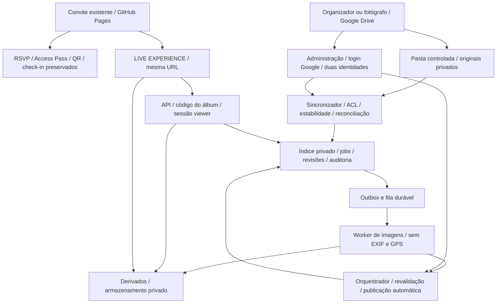

# Arquitetura do LIVE EXPERIENCE — consolidação 04A.2

**Status:** decisão de negócio aprovada na conversa; mecanismos técnicos propostos, sem backend implementado.

**Base funcional:** commit b1111a5, branch feature/live-experience. **Referência:** 07/11/2026.

**Evento:** sábado, 28/11/2026, às 21h em Belém/PA (UTC−03), Edifício Dhahram.

Esta revisão substitui a proposta de aprovação humana por fotografia do Marco 04A. Colocar uma fotografia autorizada na pasta controlada de publicação será a aprovação editorial: a publicação será automática depois das verificações técnicas. Não exige painel de aprovação individual.

A decisão não aprova provedor, contratação, credenciais, acesso ao Drive ou implantação. Node.js permanece candidato. Nenhum recurso real foi consultado ou criado. Valores de frequência, tamanho, TTL e capacidade abaixo são propostas para ensaio, sem garantia de publicação instantânea.

## 1. Evidência atual e limites

| Componente | Já implementado no frontend do Marco 03 |
| --- | --- |
| Convite, token, RSVP, Access Pass, QR e check-in | Integrações preservadas; backend de credenciamento fora do escopo. |
| Fonte pública | `createPublicSource()` retorna `coming-soon`; sem fotos reais ou conexão com Drive. |
| Contrato | `normalizeSnapshot()` aceita `coming-soon/open`, filtra `published`, valida metadados/URLs e converte datas ISO. |
| Interface | Mosaico, diálogo acessível, seis itens por lote local, lazy loading, atualização manual, timeout e redução de movimento. |
| Atualização | Refresh substitui a lista e fecha o visualizador; não existe merge incremental, paginação remota ou polling. |
| Contexto | Navegação preserva `token/confirmado` para retornar ao convite; não autentica a galeria. |
| Demonstração | Separada, identificada e sem registros reais; não é ambiente autenticado. |
| Service Worker | v7: allowlist estática; API, mídias futuras e demonstração fora do pré-cache. |
| A implementar | Login administrativo, código do álbum, conector Drive, ACL, sincronização, processamento, publicação automática, índice, auditoria e backup. |

A evidência funcional é a auditoria do Marco 04A sobre b1111a5; a homologação anterior pertence ao Marco 03. Nesta consolidação houve revisão documental, sem repetir testes de navegador ou testar backend real.

## 2. Invariantes e decisões aprovadas

1. Acesso pelo card LIVE EXPERIENCE e pela URL existente no GitHub Pages; Black & Gold e contexto de retorno preservados.
2. Antes de fotos publicadas, mostrar Em breve. Sem telão, TV, projeção ou upload de convidados.
3. Somente organizador e fotógrafo oficial podem colocar arquivos na pasta de publicação e administrar o módulo; sem cadastro aberto de publicadores.
4. Presença de fotografia na pasta controlada é autorização editorial, condicionada à segurança da pasta/arquivo, estabilidade e validação. Não atribuir autoria pelo change feed.
5. Drive armazena originais privados; a galeria entrega somente derivados autorizados e otimizados, sem alterar originais ou tornar a pasta pública.
6. Convidados acessam por código próprio do álbum, independente do RSVP e não embutido no frontend. Não podem publicar, editar, excluir ou acessar Drive.
7. Backend, cotas, credenciais e dados da galeria isolados do RSVP, Access Pass, QR, check-in, planilha e Apps Script. Nenhum prazo de confirmação é redefinido.
8. Segredos não entram no Git, documentação, logs ou código cliente. Serviços pagos e publicação operacional exigem autorização própria.
9. Qualquer estado de segurança indeterminado impede novas publicações. Continuidade da leitura tem validade limitada, sem mascarar perda de sincronização.

## 3. Comparação das alternativas

| Critério | A. Apps Script separado | B. API Node.js ou Python | C. Supabase gerenciado |
| --- | --- | --- | --- |
| Autenticação | Execução como usuário ou provedor externo verificado. Identidade disponível precisa ser provada com as duas contas. | OIDC Google no servidor; sessão administrativa no mesmo domínio da API. | Google via Supabase Auth; política adicional para restringir publicadores. |
| Autorização | Allowlist no servidor em cada função; modo “executar como proprietário” não identifica necessariamente o visitante. | Middleware por ação/evento, allowlist estável de duas identidades e transações. | RLS e funções autorizadas; usuário autenticado não se torna publicador automaticamente. |
| Originais | Drive privado, mas escopos e identidade de execução precisam de isolamento efetivo do RSVP. | Conector Drive com escopo mínimo e credencial isolada. | Drive continua sendo a origem privada; Supabase não o substitui. |
| Miniaturas | Transformação e entrega binária limitada; pré-processamento externo tende a ser necessário. Não é CDN. | Worker gera derivados uma vez; entrega por object storage privado. | Storage privado para derivados. Resize gerenciado não está incluído no plano Free consultado. |
| Cotas e custo | Sem presumir compra adicional, mas sujeito às cotas da conta, armazenamento e processamento externo. | Custos de execução, banco, armazenamento, tráfego, logs, fila e segredos; franquias não garantem gratuidade. | Free com limites pequenos e pausa por inatividade; upgrade e transformação paga exigem autorização. |
| Simultaneidade | Gargalo por identidade e execução; separar apenas o projeto pode manter cotas compartilhadas com o RSVP. | API e worker dimensionados separadamente; leitura não consulta Drive por convidado. Exige teste de carga. | Dados/objetos gerenciados ajudam, mas CPU compartilhada, egress, conexões e funções precisam de medição. |
| Complexidade | Baixa para protótipo de metadados; cresce ao exigir autenticação entre domínios, mídia e controle HTTP. | Média/alta inicial, com contratos e isolamento explícitos. Node reduz diversidade de linguagens; Python é alternativa equivalente. | Média; menos infraestrutura própria, mas integração Drive, RLS e processamento continuam necessários. |
| Manutenção | Simples com pouco volume; diagnóstico e HTTP menos flexíveis. | Atualizar runtime, bibliotecas, IAM, alertas e rotinas de recuperação. | Manter políticas, migrações, quotas, exportações e dependências da plataforma. |
| Indisponibilidade | Cotas, identidade não disponível, consentimento, rede e falhas do Web App. | Cold start, saturação, falha de banco/fila, faturamento ou OAuth revogado; mitigar por isolamento e contingência. | Pausa Free, limites, erro em RLS, indisponibilidade do projeto e perda de acesso ao Drive. |

### 3.1 Fatos relevantes das plataformas

- Apps Script: a documentação lista 6 min por execução, 30 execuções simultâneas por usuário e 1.000 por script. Essas unidades não equivalem a “convidados suportados”. Uma execução como proprietário pode concentrar as cotas nele. [Cotas oficiais](https://developers.google.com/apps-script/guides/services/quotas)
- O modo de execução altera a identidade efetiva. `getActiveUser().getEmail()` pode retornar vazio em Web Apps que executam como proprietário; nunca usar isso como autenticação implícita. [Web Apps](https://developers.google.com/apps-script/guides/web), [Session](https://developers.google.com/apps-script/reference/base/session)
- ContentService entrega conteúdo textual e redireciona respostas. Não oferece a mesma superfície de controle de uma API HTTP convencional; provar CORS, preflight, cabeçalhos e operações necessárias. Não contornar privacidade com JSONP. [Content Service](https://developers.google.com/apps-script/guides/content)
- Cloud Run cobra recursos e tem opções de concorrência; o valor configurado não prova capacidade do aplicativo. Uma franquia Cloud exige conta de faturamento; expiração de trial pode interromper recursos. [Preços](https://cloud.google.com/run/pricing), [Concorrência](https://docs.cloud.google.com/run/docs/configuring/concurrency), [Programa gratuito](https://docs.cloud.google.com/free/docs/free-cloud-features)
- Supabase Free consultado: 500 MB de banco, 1 GB de Storage, 5 GB de egress e 5 GB de cached egress em categorias distintas, até dois projetos ativos e pausa após uma semana sem atividade. Não somar as categorias como franquia universal nem interpretar “requisições ilimitadas” como capacidade ilimitada. [Preços oficiais](https://supabase.com/pricing)
- Edge Functions: 256 MB de memória, 2 s de CPU por requisição e limite de duração Free de 150 s. Não planejar decodificação de fotografias grandes nelas sem prova; usar worker adequado. Resize de Storage consultado requer Pro ou superior. [Limites](https://supabase.com/docs/guides/functions/limits), [Transformações](https://supabase.com/docs/guides/storage/serving/image-transformations)
- RLS deve negar escrita de visitantes. Chaves de serviço podem contornar RLS e nunca pertencem ao navegador. [RLS](https://supabase.com/docs/guides/database/postgres/row-level-security), [Storage](https://supabase.com/docs/guides/storage/security/access-control)

Se C for escolhida, manter Auth administrativo atrás de sessão de servidor, sem persistir tokens do provedor no localStorage. Vincular a identidade verificada à allowlist privada; papéis não podem vir de metadados editáveis pelo usuário. Chave publicável de cliente não é credencial administrativa, mas tampouco substitui RLS. Banco e buckets negam acesso por padrão; somente derivados publicados recebem autorização de leitura. Supabase Auth não elimina a conexão OAuth separada com o Drive.

### 3.2 Recomendação fundamentada, ainda não aprovada

**Preferir B: API independente em Node.js LTS suportado pelo provedor, worker de imagens separado e infraestrutura exclusiva da galeria.** Python é substituto viável se a operação preferir essa pilha.

Referência concreta para orçamento/piloto: Cloud Run (API e worker), Firestore (índice e estado), Cloud Storage privado (derivados), fila durável com autenticação entre serviços e cofre de segredos. São componentes propostos, não recursos existentes nem serviços contratados. Região, produtos finais e orçamento dependem de aprovação.

Motivo: autenticação verificável, processamento assíncrono, entrega de mídia separada do Drive e controle de falhas sem acoplar cotas ao RSVP. A maior complexidade inicial é aceita somente se houver responsável por operação e prazo de homologação.

A é alternativa para um piloto reduzido, condicionada à prova de identidade e de isolamento das cotas. C é a segunda candidata quando Auth/Postgres/Storage gerenciados simplificarem a operação; ainda exige worker para fotos e revisão de limites. **Se o orçamento autorizado for estritamente zero e nenhuma alternativa passar nos testes, manter Em breve; não relaxar privacidade ou compartilhar o Drive para forçar a entrega.**

## 4. Topologia proposta



A seta de mídia G → S exige URL temporária autorizada; não significa bucket público. O painel administrativo pode ter origem própria da API, sem mudar o acesso dos convidados. Não há upload de fotos pela aplicação no MVP: os dois publicadores usam o Drive.

Worker processa; orquestrador decide a transição automática com base na autorização editorial representada pela pasta. São identidades técnicas restritas, não um terceiro publicador humano. Serviços internos exigem identidade, audiência e lease verificados; cookie administrativo ou sessão viewer não autenticam jobs. IAM de um serviço Cloud Run não constitui ACL por caminho HTTP. [Autenticação entre serviços](https://docs.cloud.google.com/run/docs/authenticating/service-to-service)

## 5. Autenticação, autorização editorial e leitura

### 5.1 Autenticação dos publicadores

Login Google com fluxo OIDC de servidor, state/nonce e callback registrado. Verificar assinatura, emissor, audiência, validade e contexto do login usando biblioteca oficial. Identidade persistida por `issuer + sub`; não aceitar e-mail fornecido pelo cliente como identidade. O login Google não concede, por si, autorização para publicar. [Verificação oficial](https://developers.google.com/identity/gsi/web/guides/verify-google-id-token)

O painel e a sessão ficam na origem da API: cookie administrativo com prefixo __Host-, Secure, HttpOnly, Path=/, sem Domain e SameSite=Lax, sujeito ao ensaio do callback escolhido; rotação no login, expiração e revogação. Proposta inicial: 30 min ociosos, máximo 8 h e nova autenticação para ações sensíveis. Proteger mutações com token CSRF e verificação de Origin. MFA das duas contas é requisito operacional proposto. [Sessões OWASP](https://cheatsheetseries.owasp.org/cheatsheets/Session_Management_Cheat_Sheet.html), [CSRF OWASP](https://cheatsheetseries.owasp.org/cheatsheets/Cross-Site_Request_Forgery_Prevention_Cheat_Sheet.html)

### 5.2 Autorização e comprovação das duas identidades

A allowlist privada contém exatamente dois pares `issuer + sub` ativos. No piloto, vincular cada um ao `permissionId` da respectiva conta Drive. São identificadores diferentes: não comparar `sub` diretamente a `permission.id` nem confiar em nome de exibição ou e-mail enviado pelo navegador.

Prova proposta: cada humano autentica e consente em fluxo de servidor com openid e escopo Drive mínimo suportado. Na mesma troca de authorization code, verificar o ID token e exigir issuer/sub iguais à identidade permitida; usar o access token desse mesmo fluxo para consultar `about.get(fields=user(permissionId,emailAddress))`. Só então registrar o permissionId associado. Não vincular tokens arbitrários recebidos do navegador nem confiar que duas janelas usaram a mesma conta. Proteger com state/nonce, confirmação do operador e teste de troca de contas. Consultar about com a credencial do sincronizador identifica apenas o sincronizador, não os dois publicadores. Credenciais e identificadores reais ficam fora deste repositório. [About](https://developers.google.com/workspace/drive/api/reference/rest/v3/about/get), [User](https://developers.google.com/workspace/drive/api/reference/rest/v3/User), [Permission](https://developers.google.com/workspace/drive/api/reference/rest/v3/permissions)

A ACL efetiva será examinada no servidor: pasta, ancestrais e cada arquivo, incluindo permissões diretas e herdadas, com todas as páginas. `inheritedFrom` é preenchido em Shared Drives; em My Drive não presumir essa informação e percorrer ancestrais conforme o modelo aplicável. O piloto deve provar que a credencial consegue observar as permissões necessárias; visibilidade incompleta ou desconhecida bloqueia publicação. [Compartilhamento](https://developers.google.com/workspace/drive/api/guides/manage-sharing), [Listar permissões](https://developers.google.com/workspace/drive/api/reference/rest/v3/permissions/list)

Política conservadora:
- Rejeitar anyone, domínio, grupo não resolvido/controlado, acesso por link público e principal desconhecido. No MVP não resolver grupos: não usá-los.
- Negar owner/writer/organizer/fileOrganizer humano fora das duas identidades. Incluir owner e permissões herdadas; verificar somente os escritores diretos não basta.
- Negar leitores externos de originais fora da allowlist privada. Identidade técnica de leitura, se necessária, deve estar explicitamente autorizada e sem escrita.
- Verificar arquivo também: pasta segura não exclui compartilhamento direto ou proprietário indevido de um arquivo.
- Operadores de infraestrutura e administradores da organização fazem parte da fronteira de confiança; documentar poderes e limitar acesso. A API não comprova ausência de superadministradores fora da ACL observável.

O feed não prova quem moveu/adicionou um arquivo. `lastModifyingUser` não prova quem o colocou na pasta. A autorização deriva da presença atual em pasta certificada, com permissões restritas, e não de um campo de ator. Depois de exposição indevida, remover uma permissão não torna confiáveis todos os arquivos já presentes: exigir nova certificação e reendosso do conjunto, conforme 7.2.

| Ação | Convidado | Organizador / fotógrafo | Image worker | Orquestrador |
| --- | --- | --- | --- | --- |
| Ler derivados publicados | Código e sessão válidos | Sessão autorizada | Somente job | Serviço autorizado |
| Colocar/mover originais no Drive | Não | Sim, ACL controlada | Não | Não |
| Aprovar editorialmente | Não | Presença na pasta controlada | Não | Apenas verifica a condição |
| Publicar automaticamente | Não | Sem segundo clique por foto | Somente entrega READY | Após todos os controles |
| Retirar da pasta | Não | Sim, pelo Drive | Não | Detecta e despublica |
| Pausar/retomar, reconciliar e ver falhas | Não | Sim, login e allowlist | Não | Executa comando autorizado |
| Alterar RSVP/check-in | Não por este módulo | Não por este módulo | Não | Não |

Rotação das duas identidades, retenção e substituição do código exigem política administrativa definida pelo responsável; não habilitar uma terceira pessoa. Revalidar autorização em cada comando e invalidar sessões revogadas.

### 5.3 Leitura por código do álbum — decisão aprovada

O card existente abre a mesma página. Em breve permanece antes das fotos; quando houver conteúdo, a própria página oferece entrada do código caso falte sessão. Não exigir nova URL, QR adicional ou token RSVP. Não embutir o código em HTML, JavaScript, query, fragmento ou card público.

Código compartilhado não identifica cada convidado: pode ser repassado. Definir distribuição privada, rotação, expiração e recuperação com o responsável. Proposta: código aleatório copiável de 12–16 caracteres Base32 (60–80 bits), não data/nome/PIN curto, hash salgado com KDF adequada no servidor (Argon2id ou scrypt), limitação de tentativas e proteção contra enumeração. Esses parâmetros ainda não foram aprovados. Geração/configuração somente na administração autorizada; nenhum segredo real neste documento.

Fluxo: POST com código no corpo, HTTPS → verificação no servidor → bearer opaco viewer, revogável e restrito ao álbum. Sessão proposta de 1 h em memória, sem localStorage/IndexedDB e sem depender de cookie de terceiro entre Pages e API. Código digitado existe transitoriamente no formulário, é apagado após troca e não pode ser registrado em logs. Reload/retorno pode exigir nova digitação: homologar essa fricção sem reaproveitar `?token=`.

Revogar/rotacionar código incrementa policyVersion e invalida sessões conforme política aprovada. URLs de mídia já emitidas têm a janela residual descrita em 10. CORS com origem explícita é controle adicional, não autenticação; a origem Pages pode ser compartilhada por outros caminhos do mesmo usuário.

## 6. Originais privados, OAuth e organização do Drive

### 6.1 Estrutura proposta, ainda não criada

| Pasta | Finalidade e efeito | Permissões |
| --- | --- | --- |
| 01_ORIGINAIS | Acervo privado fora do conjunto editorial; não publicar ao detectar aqui. | Somente os dois humanos; leitor técnico apenas se necessário e autorizado. |
| 02_PUBLICAR_NA_GALERIA | Arquivos diretos aqui representam aprovação editorial; são os originais privados usados na publicação. | Somente os dois humanos escrevem; serviço explicitamente permitido só lê. Sem público, convidados, domínios ou grupos. |
| 03_RETIRADAS (opcional) | Destino privado para movimentação humana de arquivos retirados de 02; não é necessário para detectar retirada. | Mesma proteção; fora da pasta 02. |
| Backup independente | Cópia criptografada com domínio de falha distinto, política e acesso próprios. | Destino/operador pendentes; outra pasta no mesmo Drive não substitui backup. |

Um arquivo Drive tem um único parent: mover 01 → 02 autoriza; mover 02 → 03 ou para fora de 02 retira. Não exigir cópias em 01 e 02 nem apagar originais. Upload direto em 02 também pode autorizar, depois de estabilizar. Se o fluxo do fotógrafo exigir cópia, deduplicar por bytes e controlar o ciclo editorial.

MVP somente arquivos de imagem diretamente em 02; não seguir atalhos, subpastas, URLs externas ou árvores recursivas. Pastas identificadas por IDs privados configurados, nunca apenas por nome ou parâmetro fornecido pelo cliente. O sincronizador não precisa mover, excluir ou alterar arquivos Drive.

### 6.2 Conta e consentimento: bloqueadores do piloto real

`drive.file` não garante acesso aos arquivos que humanos colocam diretamente pelo Drive em uma pasta. A baseline antiga de upload criado pelo aplicativo deixa de ser suficiente para este fluxo. Não prometer que escolher uma pasta concede automaticamente acesso a todos os filhos presentes e futuros. [Escopos oficiais](https://developers.google.com/workspace/drive/api/guides/api-specific-auth)

Alternativas a provar, sem escolha de conta nesta etapa:
1. OAuth de uma das duas identidades humanas, em contexto de armazenamento dedicado e sem dados/planilha RSVP. Escopo de leitura pode alcançar todos os arquivos acessíveis à conta; uma allowlist no código não reduz o consentimento concedido.
2. Shared Drive/pasta com leitor técnico dedicado e acesso explicitamente limitado, se o tipo de conta e as políticas permitirem. Sem delegação de domínio. Provar propriedade, visibilidade de ACL e funcionamento com arquivos de ambos os publicadores.

`drive.readonly` e escopos de metadados relevantes são restritos; avaliar verificação OAuth e eventual avaliação de segurança conforme uso, armazenamento/transmissão e exceções aplicáveis. Não presumir isenção, custo zero ou conclusão antes da festa. Se não for possível obter privilégio mínimo, inspeção suficiente e isolamento real, o piloto não passa.

Refresh tokens e segredos em cofre fora do Git; rotação/revogação e renovação ensaiadas. Aplicação externa em Testing pode ter refresh token de sete dias para esses escopos: não operar a festa com consentimento que expira sem plano comprovado. Usar só openid/email não lê Drive. [OAuth e expiração](https://developers.google.com/identity/protocols/oauth2)

## 7. Sincronização e publicação automática

### 7.1 Comparação dos mecanismos Drive

| Método | Cotas/custo | Confiabilidade e limites | Latência e adequação |
| --- | --- | --- | --- |
| Varredura completa files.list por parent de 02 | Uma chamada por página por ciclo, mais ACL, metadados e downloads. Cresce com acervo. | Estado atual simples; enumerar todas as páginas, sem incompleteSearch, confirmar ausências. Não reconstrói toda ação intermediária. | Intervalo controla atraso; candidato ao MVP com acervo limitado e teste de custo. |
| changes.list + reconciliação completa | Consome páginas de mudanças da conta/Shared Drive, não apenas da pasta; ruído de outras áreas pode aumentar custo. | Cursor e fila duráveis, replay idempotente; resolve arquivos contra estado atual. Não prova autor e não substitui auditoria de ACL/reconciliação. | Pode reduzir leituras de inventário em acervo grande; candidato de evolução, não obrigatório para o primeiro piloto. |
| changes.watch como sinal + changes.list + reconciliação | Canal, endpoint HTTPS e renovações, além das chamadas do feed. | Notificação sem detalhe do arquivo/autor; perda, duplicação e vencimento não podem comprometer correção. Polling permanece. | Pode antecipar um ciclo, sem garantia de instantaneidade. Complexidade adicional para MVP. |
| files.watch de pasta isoladamente | Canal e renovação por recurso. | Não tratar como feed recursivo confiável de todos os filhos/ACL; insuficiente sozinho para inclusões/retiradas. | Descartado como mecanismo único. |

Referências: [Changes](https://developers.google.com/workspace/drive/api/guides/manage-changes), [changes.list](https://developers.google.com/workspace/drive/api/reference/rest/v3/changes/list), [files.list](https://developers.google.com/workspace/drive/api/reference/rest/v3/files/list), [notificações](https://developers.google.com/workspace/drive/api/guides/push).

**Candidato ao MVP de 28/11:** files.list filtrado pelo parent, ciclo inicial proposto de 60 s, checkpoint e reconciliação completa; nenhum webhook obrigatório. É alternativa documentada ao changes.list. Configurar corpus/driveId e supportsAllDrives conforme a conta aprovada. Não usar busca allDrives incompleta nem reduzir a consulta a um subconjunto sem conhecer o acervo.

Scheduler durável com invocação autenticada e lease de uma execução por álbum; não depender de setInterval em processo que pode ser suspenso/encerrado. O provedor do agendamento ainda não foi escolhido. Se a medição reprovar varredura/ACL, adotar feed ou reduzir escopo operacional, sem afrouxar segurança.

### 7.2 Certificação inicial e histórico de permissões

Iniciar com publicação pausada. Inspecionar e registrar ACL, ancestrais, identidade/propriedade e conjunto de permissões permitido. Preferir pasta inicialmente vazia e certificada. Se já houver arquivos, uma das duas pessoas deve reendossar explicitamente o conjunto após a certificação, ou remover e recolocar os arquivos sob o novo securityEpoch. Isso é um aceite de ativação/conjunto, não um painel obrigatório por foto.

ACL atual não prova que um terceiro nunca teve acesso no passado. Após incidente de permissões, invalidar a certificação, bloquear novas publicações e leitura conforme 10, retirar/quarentenar gerações afetadas e exigir revisão do conjunto e retomada humana auditada. Não publicar automaticamente o backlog somente porque a permissão indevida foi removida.

### 7.3 Algoritmo do ciclo completo

1. Adquirir lease do álbum; ler publishingPaused, securityEpoch e estado operacional duráveis. Examinar ACL completa da pasta/ancestrais; falha ou exposição impede novas publicações.
2. Listar todos os filhos diretos não trashed de 02 com campos mínimos: id, parents, version, modifiedTime, size, mimeType, md5Checksum. Paginar integralmente, conferir incompleteSearch e registrar scanId/conclusão.
3. Registrar observações e jobs em transação/outbox. Comparar contra gerações conhecidas. Não avançar checkpoint além do que foi duravelmente registrado.
4. Arquivo novo/alterado vai a STABILIZING; nova observação posterior confirma estabilidade. Arquivo conhecido ausente exige consulta individual para resolver membership/trashed/acesso antes de retirar.
5. Para cada candidato estável, verificar ACL do próprio arquivo e a certificação da pasta. Fazer download privado limitado, validar e processar.
6. Antes de commit automático, consultar estado atual da origem e permissões novamente; conferir fingerprint, membershipEpoch, securityEpoch, policyVersion, pausa e lease. Falha cancela/segura a publicação.
7. Somente derivados completos/verificados entram no índice. Commit atômico publica foto, revisão, mudança e auditoria; nenhuma URL parcial é entregue.
8. Reconciliar retiradas, jobs travados e objetos órfãos com prioridade sobre novas fotos. Executar varreduras completas mesmo se houver feed no futuro. Propor auditoria de ACL de todos os arquivos publicados a cada 120 s, em lotes limitados, além da pasta/ancestrais em cada ciclo e da verificação antes de publicar. Só renovar o lease individual depois da auditoria completa e válida; atraso não pode renovar frescor por suposição.

Scan incompleto, erro de página, token de paginação rejeitado, timeout ou 403 não equivalem a pasta vazia. Reiniciar varredura inválida e manter checkpoint seguro. Nunca fazer despublicação em massa a partir de lista parcial. Perda global de permissão aciona bloqueio de segurança/expiração de leases, não uma falsa confirmação de exclusão de todos os originais.

### 7.4 Variante com change feed e notificações

Se adotada, capturar getStartPageToken antes do inventário inicial, concluir o inventário e consumir mudanças a partir desse ponto para cobrir a janela de bootstrap. Escolher escopo de conta/Shared Drive e manter cursor isolado por conexão e securityEpoch. changes.list não tem filtro por parent: filtrar e refazer files.get no servidor, inclusive para arquivos conhecidos que saíram da pasta.

Persistir nextPageToken somente junto ao registro durável dos itens da página/outbox; newStartPageToken só após a página final. Processamento é at-least-once, não exactly-once. Os tokens do feed não expiram por tempo segundo a API: não inventar renovação diária. Contexto inválido/corrompido ou mudança de conta/escopo exige bootstrap controlado; 401/403 não se resolve descartando cursor e expondo dados. O cursor da API própria de convidados tem política diferente.

Change.removed pode indicar perda de acesso, não apenas exclusão. O objeto Change não identifica o autor da ação. Metadados de último modificador não certificam colocação editorial. Resolver estado atual; se a origem individual deixa de ser verificável, suspender sua geração e não publicá-la novamente por replay. [Change](https://developers.google.com/workspace/drive/api/reference/rest/v3/changes), [Token inicial](https://developers.google.com/workspace/drive/api/reference/rest/v3/changes/getStartPageToken)

Se houver push, validar canal/resourceId/token secreto e usar somente como wake-up para buscar feed autenticado; não processar como comando de publicação. Canais expiram: máximo documentado de sete dias para changes e um dia para files, padrão de uma hora, com renovação explícita e possível sobreposição. Sem renovação/push, polling e reconciliação continuam. O remetente do sinal não é o humano editor.

### 7.5 Estabilização, validação e derivados

Não existe presunção de upload completo por simples aparição do arquivo. Proposta inicial:
- Duas observações separadas por pelo menos 30 s com tupla id/version/size/md5/modifiedTime/parents estável e tamanho maior que zero; na varredura de 60 s isso normalmente exige outro ciclo.
- Arquivos binários JPEG, PNG e WebP estáticos; até 20 MiB e 40 megapixels, sujeitos a ensaio com câmera real. Rejeitar SVG, GIF/animação, HEIC/RAW no MVP, atalhos e documentos; orientar exportação do fotógrafo.
- MIME, assinatura de bytes e decodificação integral consistentes; limites de CPU, memória, pixels e timeout contra bombas de descompressão.
- Download por ID confiável, streaming limitado, comparação de tamanho/checksum MD5 quando disponível e SHA-256 calculado. MD5 auxilia integridade de transporte, não é prova de segurança/autoria. Checksum ausente/estado não verificável leva a espera/quarentena.
- Reconsultar metadados após download e antes de publicação; se mudou, descartar derivados dessa tentativa e reiniciar estabilização.

Gerar thumbnail e display a partir da orientação correta, remover EXIF/GPS e metadados pessoais dos derivados, verificar novamente decodificação/checksum/dimensões. Original permanece intacto, inclusive seus metadados privados. Proposta: thumbnail até 480 px e display até 1600 px no lado maior, sem upscaling; orçamento de bytes/qualidade medido no piloto. Não entregar link de original ou thumbnailLink temporário do Drive. [Campos de arquivo](https://developers.google.com/workspace/drive/api/reference/rest/v3/files)

Alt inicial neutro e seguro, sem inventar identidade, reconhecimento facial, geolocalização ou descrição de conteúdo não verificado; permitir enriquecimento editorial futuro sem fazer dele um gate de publicação por foto.

### 7.6 Estados, idempotência e duplicidade

Fluxo proposto: DISCOVERED → STABILIZING → VALIDATED → PROCESSING → READY → AUTO_PUBLISHED. Alternativas: REJECTED, FAILED, DUPLICATE e WITHDRAWN. READY não é leitura pública. Image worker só conclui processamento; orquestrador tem a única transição de publicação automática.

Chave lógica de job: eventId + driveFileId + contentHash + membershipEpoch + processingVersion. Se version muda sem mudar bytes, revalidar política/metadados sem duplicar foto. Commit com compare-and-set da geração, securityEpoch e publicationControlVersion impede job antigo de superar retirada/pausa recente. Auditoria registra actor=automation, editorialBasis=controlled-folder-presence e evidência de ACL/certificação; actor humano fica desconhecido se não comprovado, jamais preenchido por suposição do feed.

SHA-256 por evento identifica bytes duplicados. Mesmo nome não significa duplicidade; mesmos bytes em dois IDs não geram dois cards. Manter um canônico e marcar duplicatas suprimidas; retirada do canônico não promove silenciosamente outra cópia e não ressuscita foto. Republicação exige nova entrada editorial/revalidação conforme política, preservando histórico/tombstone. Testar remoção/reentrada e arquivos idênticos.

Substituição binária em arquivo publicado suspende a geração anterior quando detectada, estabiliza e valida a nova. O objeto derivado usa geração imutável, sem sobrescrever cache antigo. Transições muito rápidas entre ciclos podem não ser reconstruídas; presença/ACL atual autorizam o estado observado, sem afirmar rastreabilidade humana perfeita.

### 7.7 Retirada, pausa e recuperação

Remoção de 02, trashed, exclusão ou perda individual confirmada de acesso torna a foto inelegível: bloquear novas URLs, atualizar índice e emitir tombstone numa transação. Confirmação individual desconhecida mantém a geração suspensa até esclarecimento. Despublicar não significa apagar original nem backup. 03_RETIRADAS é conveniência humana, não dependência técnica.

Botão administrativo obrigatório “Suspender novas publicações”, somente para os dois logins permitidos. Flag durável, versionada e auditada; começa pausada até ativação autorizada. Pausa impede novos commits, inclusive jobs em voo, mas não impede detecção de retirada, reconciliação, auditoria ou diagnóstico. READY aguarda; retomar revalida tudo, sem esvaziar backlog cegamente.

Estados operacionais distintos: PAUSED (comando), HEALTHY, SYNC_DEGRADED (dependência/frescor insuficiente) e SECURITY_BLOCKED (ACL/identidade insegura). Incidente de segurança não se resolve por retry automático de publicação. Retries transitórios com jitter/backoff e limite; falha permanente em quarentena, jobs vencidos recuperados por lease. Reconciliação compara fonte, índice, tombstones e derivados, sem publicar objetos órfãos.

Não há transação distribuída entre ACL do Drive e banco: há janela entre a última verificação e o commit. Reduzir com revalidação, epochs, certificados de curta duração e auditoria periódica; medir risco residual no piloto. Se a política exigir comprovar o autor humano de cada inclusão, este modelo de pasta/feed não atende sozinho e precisará de nova decisão.

## 8. Modelo de dados proposto

| Entidade | Campos privados principais / função |
| --- | --- |
| Event | id, startsAt, lifecycle, everPublished, revision, publishedCount, retentionUntil, readPolicy=album-code |
| Publisher | issuer, subject, drivePermissionId, active, role, sessionVersion, bindingVerifiedAt |
| SyncConnection | conta/drive/folder IDs, strategy, cursor, checkpoint, lastCompleteScanAt, credentialReference; nunca segredo no índice público |
| PublicationControl | publishingPaused, controlVersion, operationalState, securityEpoch, certificationId, lastAclVerifiedAt, freshnessUntil |
| SourceEntry | driveFileId, observedVersion, size/md5/sha256, parents, stableSince, membershipEpoch, generation, state, lastVerifiedAt |
| Photo | id opaco, eventId, sourceEntryId, sourceGeneration, state, firstPublishedAt, updatedAt, version, canonicalHash, editorialBasis |
| Derivative | photoId, variant, objectKey/generation, mime, width/height, bytes, checksum, ready |
| Job/Outbox | idempotencyKeyHash, sourceGeneration, policyEpoch, attempt, leaseUntil, nextAttemptAt, result/errorCode |
| Change/Tombstone | eventId, revision, photoId, action upsert/withdraw, sourceGeneration, occurredAt |
| AlbumCode/ReaderSession | hash/KDF parâmetros, policyVersion, role viewer, expiresAt/revokedAt; sem ligação ao RSVP |
| Audit/Certification | ator humano comprovado ou técnico, ação, conjunto ACL permitido, evidência/checkpoint, transição/resultado, horário |

Índices por evento/estado/primeira publicação/ID, evento/revisão e job/próxima tentativa. Unicidade de geração e idempotência transacionais. Ordenação estável por primeira publicação + ID, não por EXIF ou nome de arquivo; política de republicação preserva histórico.

DTO do convidado exclui Drive IDs, e-mails, nomes originais, GPS, subjects, ACL, logs, segredos e URLs de originais. Auditoria de automação nunca deve alegar que identificou o autor humano pela notificação.

## 9. Contratos de API propostos — versão 1

Todos os endpoints abaixo ainda serão implementados. HTTPS; host definido depois. Nunca enviar bearer/flag do RSVP à API.

### 9.1 Leitura na URL existente

| Método e rota | Comportamento |
| --- | --- |
| GET /v1/events/{eventId} | Metadados mínimos, phase e accessRequired; não lista acervo privado nem código. |
| POST /v1/events/{eventId}/reader-sessions | Código no corpo; limite de tentativas; devolve sessão opaca viewer. |
| DELETE /v1/reader-sessions/current | Revoga a sessão apresentada. |
| GET /v1/events/{eventId}/photos?limit=24&cursor=... | Sessão válida, lease operacional e estado publicado; máximo proposto de 60. |
| GET /v1/events/{eventId}/changes?after=... | Upserts, IDs retirados, revisão e serverTime, com a mesma autorização. |
| POST /v1/events/{eventId}/photos/{photoId}/media | Revalida foto/política/frescor e emite URLs apenas de derivados. |

Corpo de troca: `{ "albumCode": "REDACTED" }`. Resposta 201: `{ "accessToken": "REDACTED", "expiresIn": 3600, "scope": "gallery:read", "eventId": "example-event" }`. Placeholders, não credenciais. Sessão recebida por Authorization Bearer, nunca em URL. Renovação de mídia recebe variante permitida, sem aceitar objectKey/URL externa do cliente.

Exemplo sintético de snapshot bruto (datas ISO normalizadas uma única vez pelo adaptador):

```json
{
  "phase": "open",
  "isDemo": false,
  "updatedAt": "2026-11-29T00:05:00Z",
  "version": "example-revision",
  "nextCursor": null,
  "photos": [{
    "id": "example-photo",
    "status": "published",
    "thumbnailUrl": "https://media.example.invalid/example-photo/v1/thumb?grant=REDACTED",
    "imageUrl": "https://media.example.invalid/example-photo/v1/display?grant=REDACTED",
    "mediaExpiresAt": "2026-11-29T00:10:00Z",
    "width": 1200,
    "height": 1500,
    "alt": "Fotografia do álbum LEVEL XVIII",
    "caption": "",
    "publishedAt": "2026-11-29T00:05:00Z"
  }]
}
```

Antes da primeira publicação: `phase: "coming-soon", photos: []`. Depois de já aberto, se todas forem retiradas: `phase: "open", photos: []`, estado vazio. Antes/durante/depois do evento: o horário da festa não publica fotos nem encerra sozinho o álbum. Pós-evento mantém leitura até retenção/encerramento aprovado. Acesso necessário/expirado e álbum encerrado são estados próprios, sem simular Em breve.

Delta: `{version, upserts: [DTO bruto], removedIds: [ID opaco], nextCursor, serverTime}`. Rever todas as páginas antes de checkpoint; cursores ligados a evento, snapshot e política. Histórico vencido exige novo snapshot. O cursor da API própria não é o token Drive nem autentica.

### 9.2 Administração e controle interno

| Método e rota | Regra proposta |
| --- | --- |
| GET /auth/google/start e callback | OIDC verificado; sem redirecionamento arbitrário. |
| POST /admin/v1/logout | Revoga sessão e cookie. |
| GET /admin/v1/events/{eventId}/sync | Estado sanitizado de ACL, frescor, fila, pausa e última reconciliação. |
| PUT /admin/v1/events/{eventId}/publication-control | Duas identidades, CSRF, If-Match; pausa/retomada versionada e auditada. |
| POST /admin/v1/events/{eventId}/reconcile | Job idempotente, não publica ignorando pausa/segurança. |
| GET /admin/v1/jobs e POST /admin/v1/jobs/{jobId}/retry | Diagnóstico e retry limitado; revalidação obrigatória. |
| PUT /admin/v1/events/{eventId}/album-code | Somente administração autorizada, reautenticação; configurar/rotacionar, nunca devolver hash/segredo em listagem. |

Não há endpoint de upload de convidado nem comando obrigatório de aprovação por foto. Upload editorial ocorre no Drive; retirada editorial normal é mover para fora da pasta. Supressão emergencial no índice pode ser adicionada sob autorização, sempre com tombstone, sem criar uma fila humana obrigatória.

Image worker recebe ID/generation/lease e só reporta READY/FAILED por canal autenticado; não escolhe folderId ou evento livremente. Orquestrador faz commit automático após todos os gates. API administrativa exige allowlist em cada rota, não apenas no login.

### 9.3 HTTP e concorrência

200/201/202 conforme resposta ou job; confirmação de publicação só no commit do índice. 400 entrada inválida; 401 sessão ausente/expirada; 403 papel insuficiente; 404 objeto não acessível; 409 versão/snapshot conflitante; 410 histórico próprio vencido ou álbum encerrado com códigos distintos; 413/415/422 validação; 429 com Retry-After; 503 indisponibilidade/bloqueio operacional, sem retornar dados privados.

Erros: `{error: {code, message}, requestId}`, sem stack/conta/arquivo. If-Match, idempotência e CAS das gerações/controle evitam corridas. Mesma chave com payload diferente é conflito. CORS explícito, mutações com CSRF administrativo e GET sem efeitos editoriais.

DTO e autenticação: Cache-Control private, no-store. ETag inclui política/revisão/validade; não usar 304 se só sobrariam URLs vencidas. Não confundir validade de histórico da API própria com tokens de changes.list.

## 10. Entrega de mídia, frescor, cache e retirada

Baseline proposta: derivados em armazenamento privado e URLs HTTPS GET assinadas, TTL máximo inicial de cinco minutos. Não é decisão final de provedor. URL assinada pode ser repassada e usada enquanto válida; não garante revogação imediata. Se exigir checagem em cada requisição, preferir proxy autenticado e homologar fetch/Blob URL, memória e validador atual HTTP/HTTPS. [URLs assinadas](https://docs.cloud.google.com/storage/docs/access-control/signed-urls)

Separar três janelas:
1. Atraso de detecção Drive: intervalo de varredura/feed + falhas. Não começa no commit do índice.
2. Depois do commit de retirada, API bloqueia novas URLs; delta da interface tem alvo proposto de até 45 s online, após medição. Esse alvo não é prazo total desde a ação no Drive.
3. URLs/bytes previamente entregues têm validade residual; bytes já baixados não podem ser recolhidos.

Proposta fail-closed de frescor operacional: lease de presença/ACL de até cinco minutos (H=300 s), a calibrar com duração do acervo/ACL. Emitir URL com expiração no máximo em min(agora+TTL, sessão expira, lease da foto/pasta expira). Sem renovação segura, parar novas emissões e não devolver fotos em listagens/deltas fora do lease; nova sessão de leitura não contorna bloqueio operacional. Não continuar indefinidamente servindo fotos por falha de sincronização. ACL insegura conhecida invalida certificação imediatamente e bloqueia novas emissões; URLs já emitidas mantêm o risco residual. Investigar exclusão/invalidação de derivados ativos conforme provedor, sem garantir instantaneidade.

Cache de mídia pessoal não é público por padrão: Cache-Control private, no-store, Referrer-Policy no-referrer na página e nas respostas, sem analytics de query assinada, sem Service Worker/localStorage/IndexedDB. A página que mantém contexto de retorno RSVP também não deve enviá-lo por Referer a API/mídia ou terceiros. Frontend limpa fotos retiradas/expiradas da memória; não há acesso offline persistente autorizado. Cache interno do índice só depois de autorizar e vinculado à política/revisão.

Nenhum endpoint deve transformar falha de origem em URL pública de Drive. Antes de produção, aceitar a janela residual ou escolher proxy; mesmo proxy não retira bytes já copiados.

## 11. Adaptação futura do frontend, sem reescrever o convite

| Atual | Mudança futura, ainda não implementada |
| --- | --- |
| publicSource coming-soon | Adaptador HTTP separado; formulário de código na mesma página, não embutido no build. |
| source.list({signal}) | Sessão viewer em memória, abort, timeout e renovação; datas ISO normalizadas uma vez. |
| Normalizador descarta extras | Preservar mediaExpiresAt no adaptador ou estender contrato explicitamente, sem normalizar datas numéricas novamente. |
| Seis itens locais | Paginação remota, lotes visuais de seis, carregamento progressivo e prefetch limitado. |
| Refresh fecha visualizador | Merge por ID/versão, preservando foco/scroll/foto aberta; retirada da atual oculta com aviso acessível. |
| Só atualização manual | Poll proposto de 30 s ±20%, pausa em aba oculta e backoff até 120 s; botão manual permanece. |
| Falha genérica | Estados acesso necessário, sessão expirada, sincronização indisponível e encerrado, além dos estados existentes. |
| URLs estáticas | Renovar antes de vencer ou uma vez após falha compatível; impedir retry infinito e revalidar publicação. |
| SW v7 | Manter allowlist estática; não interceptar/cachar API autenticada, painel e mídias privadas. |

Não transmitir contexto RSVP à API; preservá-lo exclusivamente para retorno ao convite e #countdown. Não mudar URLs do convite ou da página live-experience/. Fonte demo continua separada e não contém credenciais nem fotos privadas. A aprovação do fluxo por código não significa que o formulário já esteja implementado.

## 12. Capacidade e custo: hipóteses para validação

Sem acesso a dados de convidados, adotar cenários sintéticos. Hipóteses: polling 30 s por 4 h, 60 thumbs de 80 KB + 10 ampliações de 450 KB por visitante, originais médios de 8 MB; unidades decimais, sem cache/retries/album posterior.

| Cenário | Leitores simultâneos | Fotos | Poll médio | Polls em 4 h | Tráfego de imagens estimado | Originais | Derivados, 530 KB/foto |
| --- | ---: | ---: | ---: | ---: | ---: | ---: | ---: |
| Pequeno | 150 | 500 | 5 req/s | 72.000 | 1,395 GB | 4 GB | 0,265 GB |
| Referência | 300 | 1.500 | 10 req/s | 144.000 | 2,790 GB | 12 GB | 0,795 GB |
| Estresse | 600 | 3.000 | 20 req/s | 288.000 | 5,580 GB | 24 GB | 1,590 GB |

São contas de dimensionamento, não previsão de público. Pico de 300 leitores × seis thumbs × 80 KB = 144 MB; concentrado em dez segundos, cerca de 14,4 MB/s antes das sobrecargas. API, banda do provedor e Wi-Fi/4G local são gargalos diferentes.

Não listar Drive nem ler toda a coleção a cada polling. Gerar índice/snapshots uma vez por mudança, usar paginação e cache interno de metadados autorizado, invalidado por revisão. Autorizar antes de usar o cache e não compartilhar resultados entre políticas distintas.

A Drive API tem limites por unidades/método para novos projetos a partir de maio/2026; a documentação consultada lista 1.000.000 unidades/min/projeto, 325.000/min/usuário/projeto, list/watch 100, leitura de metadados 5 e download 200 unidades. Projetos legados e limiares diários exigem conferência específica. Não usar números antigos como orçamento garantido. [Limites oficiais](https://developers.google.com/workspace/drive/api/guides/limits)

Sincronização é independente dos polls de convidados: nunca uma chamada Drive por convidado. Fórmula de orçamento: ciclos/min × páginas × peso do método + auditorias ACL paginadas + metadados + downloads + retries. Exemplo ilustrativo, sem ACL: 1.500 fotos em duas páginas, uma varredura/min = 200 unidades/min; feed de uma página a cada 30 s também = 200/min. Não assumir que feed sempre custa menos.

ACL pode dominar: se cada permissions.list custar 100 unidades e 1.500 arquivos forem auditados a cada dois minutos, seriam 75.000 unidades/min antes de paginação/retries. Cadência e lease de cinco minutos devem ser provados juntos; um acervo cujo ciclo não termine dentro do lease reprova a configuração. Medir consumo real e elegibilidade do projeto, em vez de extrapolar apenas requests HTTP.

Latência total = espera até detecção + estabilização (normalmente outro ciclo no MVP) + fila + download/processamento + commit + poll do celular. Medir p50/p95 por etapa; estabelecer SLO depois do piloto. Não prometer instantâneo ou 45 s desde o envio pelo Drive.

TCO inclui runtime, scheduler/fila, banco/operações, transformações, tráfego, armazenamento de originais/derivados, backup independente, logs/cofre e eventual verificação OAuth/avaliação de segurança. Aprovar conta, região, teto e operação antes de provisionar. Franquia não é SLA nem garantia de custo zero. [Storage](https://cloud.google.com/storage/pricing), [Budgets](https://docs.cloud.google.com/billing/docs/how-to/budgets)

Aplicar limites por sessão e tentativas de código compatíveis com NAT de convidados; não bloquear toda a festa por um IP compartilhado. Limitar concorrência/instâncias e alertar custo/backlog. Alertas não são corte automático de gastos; suspensão orçamentária também pode suspender leitura. Nenhuma regra deve alcançar o RSVP.

## 13. Falhas e observabilidade

| Falha | Resposta planejada |
| --- | --- |
| OAuth 401/invalid_grant | Pausar novos jobs/publicações; alerta e renovação segura; leitura só dentro de leases ainda válidos. |
| ACL insegura ou incompleta | SECURITY_BLOCKED; não publicar, revalidar/retirar afetadas, impedir nova emissão insegura; retomada humana certificada. |
| 403 de acesso | Distinguir perda de permissão de cota; nunca interpretá-lo como inventário vazio ou resolver ampliando escopos automaticamente. |
| 429/5xx/rede | Backoff com jitter, fila durável, limite e reconciliação; não confirmar publicação. |
| Arquivo incompleto/alterado | Manter estabilizando ou rejeitar; novas gerações invalidam tentativas velhas. |
| Worker sem memória/arquivo inválido | FAILED sanitizado; retry só quando transitório, limites de bytes/pixels/tempo. |
| Banco/fila fora | Checkpoint não avança sem outbox; replay idempotente após recuperação. |
| Derivado ausente | Não publicar geração incompleta; retirar/recuperar apenas se origem ainda elegível. |
| Scheduler/webhook perdido | Monitorar último ciclo; reconciliação durável; leases vencem com leitura bloqueada. |
| API/orçamento indisponível | Mensagem honesta, backoff e manual; convite preservado; sem pasta pública como fallback. |

Logs com requestId, scanId/jobId, geração, revisão, código/duração e ator técnico; auditoria humana restrita só quando identidade comprovada. Redigir código do álbum, bearer, cookie, OAuth, query assinada, dados de convidados e GPS. Métricas sem rastrear cada convidado: idade da última varredura/ACL completa, publicação pausada, backlog, estabilização, duração do processamento, atraso de detecção/retirada, erros, unidades Drive, bytes/custos, expiração de canal e consentimento.

Propor alertas de ciclo/frescor próximo do limite, fila >2 min e 5xx >2%/5 min; calibrar no piloto. Painel mostra última verificação real e causa sanitizada, não alega “ao vivo” durante falha.

## 14. Ameaças e testes de controle

| Ameaça | Controle a provar no 04B |
| --- | --- |
| Terceira conta/grupo/domínio/escritor herdado | ACL completa, duas identidades vinculadas, deny by default. |
| Confundir notificação/lastModifyingUser com autor | Autor humano desconhecido; sinal apenas dispara consulta; auditoria registra base editorial correta. |
| Arquivos de época de ACL comprometida | Certificação, securityEpoch e reendosso de conjunto, sem liberar backlog automaticamente. |
| Alteração/retirada/pausa durante job | Revalidação antes de commit e CAS de geração/controle; tombstone prevalece. |
| Corrida Drive ACL × DB | Lease curto, auditoria e risco residual explícito; não prometer atomicidade entre serviços. |
| Lista parcial/página repetida/cursor incorreto | Completar inventário, checkpoint com outbox e replay; sem despublicação em massa por erro. |
| Duplicata promovida após retirada | Canônico e duplicatas suprimidas; sem ressurreição automática. |
| Arquivo malicioso/SSRF/bomba | ID configurado, sem URL arbitrária, decodificação/limites, sandbox e bibliotecas atualizadas. |
| IDOR/papel forjado/callback falso | Autorizar cada objeto/rota; OIDC verificado, CSRF e identidade técnica/lease. |
| Adivinhação/repasse do código | Entropia/KDF, limite de tentativas NAT-safe, rotação; aceitar conscientemente risco de compartilhamento. |
| Token RSVP ou segredo vazando | Não enviar à API; cofre, redaction, no-referrer e nenhum segredo persistente no cliente. |
| Cache ou backup reabrindo foto retirada | Tombstones, geração, policyVersion, no-store e ensaio de restauração. |
| Sobrecarga/falha do módulo afetando evento | Projetos, cotas e credenciais separados; carga sintética e contingência sem tocar RSVP. |

## 15. Backup, recuperação e contingência

Backup criptografado independente dos originais, índice, configurações e auditoria, com checksums e política de retenção própria. Outra pasta na mesma conta Drive não protege contra perda da conta, indisponibilidade ou revogação. Destino, operador e custo ainda pendentes.

Propor RPO 15 min para índice/publicações e RTO 60 min para leitura, sujeitos a ensaio; RPO dos originais depende da cópia independente e deve ser decidido separadamente. Fotógrafo mantém cópia local durante captura. Salvar apenas no Drive não comprova backup concluído.

Restauração isolada: verificar integridade, reaplicar tombstones/pausa/revogação atuais, refazer certificação e consultar membership antes de qualquer republicação. Não reativar fila antiga indiscriminadamente nem reutilizar credenciais comprometidas. Backup/versionamento não deve disponibilizar derivado retirado. No Supabase, backup do banco não inclui objetos do Storage. [Backups](https://supabase.com/docs/guides/platform/backups)

Contingência: suspender novas publicações; preservar originais locais/privados e registros; comunicar indisponibilidade; convidados veem só conteúdo ainda autorizado dentro do lease. Sem garantias de leitura segura, bloquear fotos; se nunca publicado, manter Em breve. Não desativar código, abrir Drive ou misturar credenciais RSVP para acelerar recuperação.

## 16. Pendências e próximos marcos

**Já aprovado:** pasta como aprovação editorial automática; dois publicadores; originais privados/derivados; código independente na página existente; sem painel obrigatório por foto e sem upload de convidados.

**Ainda pendente:** provedor/runtime (Node candidato), orçamento/conta/região, disponibilidade operacional; tipo de Drive/propriedade/visibilidade ACL; escopos/consentimento/verificação; vínculo comprovado dos dois humanos; mecanismo/frequência de sincronização após medição; formatos/volume real; código/distribuição/rotação/expiração; TTL/proxy e janela residual; backup/retenção e metas medidas.

MVP para 28/11/2026 é condicional a piloto seguro, custo autorizado e homologação antes da festa. Se OAuth/infraestrutura não passarem a tempo, manter a fonte pública atual Em breve, sem atalhos de privacidade. Não iniciar provisionamento pela aprovação deste texto.

Sequência, testes e gates em [Plano de implementação](PLANO_IMPLEMENTACAO.md); decisões consolidadas e superadas em [Registro de decisões](REGISTRO_DECISOES.md). Documento Mestre e arquivos funcionais não fazem parte desta revisão.
